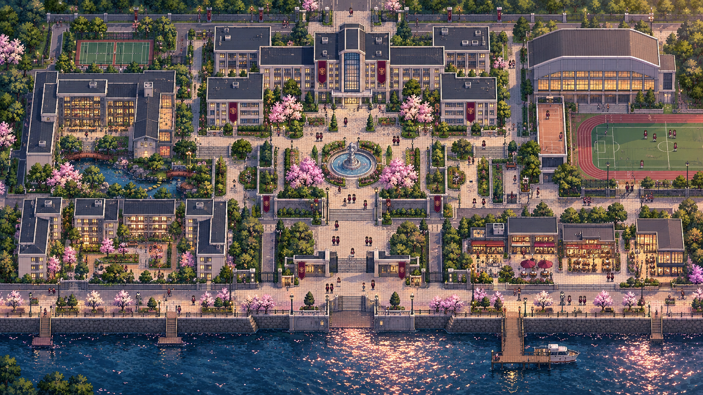
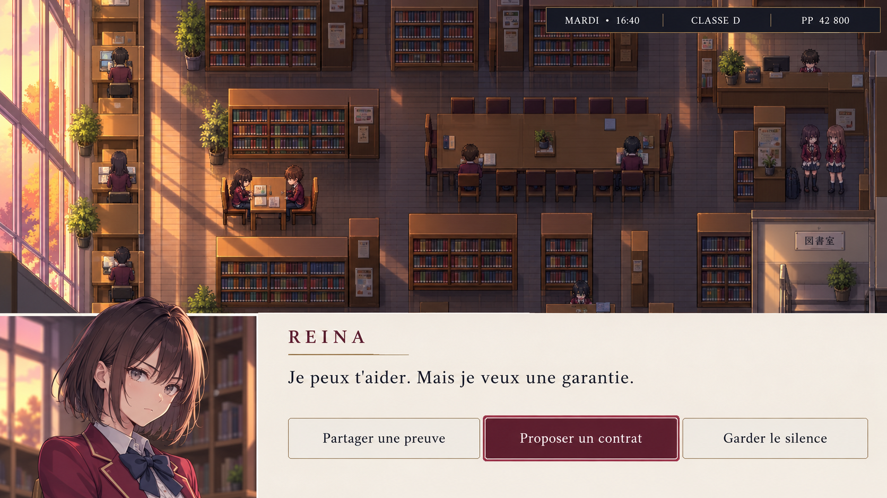
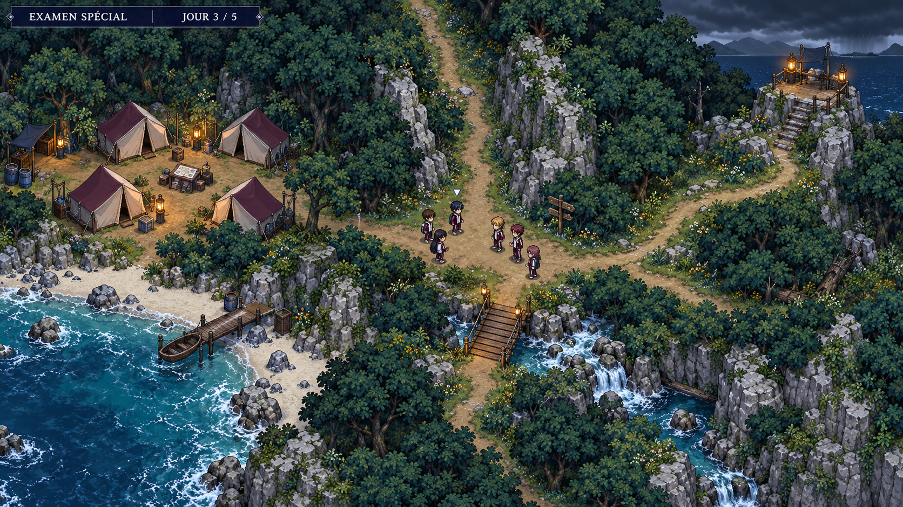
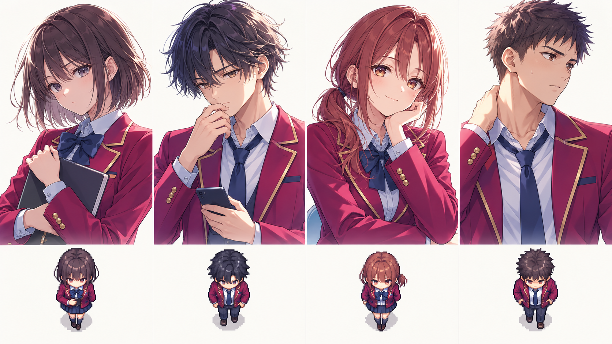

# Galerie — Les Règles Invisibles

Quatre concepts originaux générés avec ImageGen intégré le 13 octobre 2026. Les images présentent une direction artistique ; le jeu et les interfaces ne sont pas encore implémentés.

## 01 — Campus

Un lycée conçu comme une petite ville : école au nord, bibliothèque à l'ouest, sport à l'est, résidences et commerces au sud, promenade au bord de l'eau. Les voies et la cour centrale donnent une structure aux rencontres.

**À conserver :** palette, organisation des quartiers, arbres, éclairage et repères architecturaux.

**À reprendre pour le jeu :** empreintes de collision, raccords de tuiles, largeur des allées et hauteur des façades pour ne pas masquer les sprites. C'est une vue d'ensemble artistique, pas une carte à importer telle quelle.

## 02 — Négociation à la bibliothèque

Le monde garde sa place à l'écran tandis qu'un portrait permet de lire le visage. Trois intentions : partager une preuve, proposer un contrat ou garder le silence. La question de confiance prend une forme concrète.

**À conserver :** cohérence de Reina avec la planche de personnages, lumière du soir, mobilier et interface ivoire/bordeaux.

**À reprendre pour le jeu :** le texte devra être rendu par le moteur, adaptable à la langue et à la taille des caractères ; les grandes étagères devront laisser voir les chemins. Tous les choix dessinés sont une maquette et ne sont pas cliquables.

## 03 — L'examen d'île

Camp, ravitaillement, balise, pont et embranchement donnent des destinations aux discussions. Le paysage fait sentir qu'une route rapide et une route prudente n'ont pas le même coût.

**À conserver :** ambiance de forêt humide, lampes, silhouettes du camp et lisibilité du carrefour.

**À reprendre pour le jeu :** cet aperçu comporte une profondeur de décor et un horizon en haut à droite. Une carte jouable devra supprimer cet horizon et aligner tous les éléments sur la projection top-down retenue. Les passages et routes seront tracés sur une grille avant production des tuiles.

## 04 — La promotion originale

De gauche à droite : **Reina Kurose**, organisatrice ; **Nao Fujita**, intermédiaire ; **Mika Tachibana**, lien social ; **Daichi Mori**, sportif. Les descriptions et objectifs sont détaillés dans la bible.

**À conserver :** silhouettes des cheveux, couleurs, expressions, langage d'illustration de light novel et correspondance avec les sprites.

**À reprendre pour le jeu :** uniformiser les accessoires, vérifier les petites tailles, redessiner les sprites sur des cellules régulières et produire les autres orientations. La planche ne constitue pas un sprite sheet animé ; les quatre personnages ne sont pas des figures canoniques de l'œuvre.

## Fichiers et méthode

Les quatre fichiers PNG sont conservés à côté de cette galerie. Les descriptions exactes et les chemins des deux références stylistiques utilisées pour la planche figurent dans [PROMPTS.md](PROMPTS.md).
