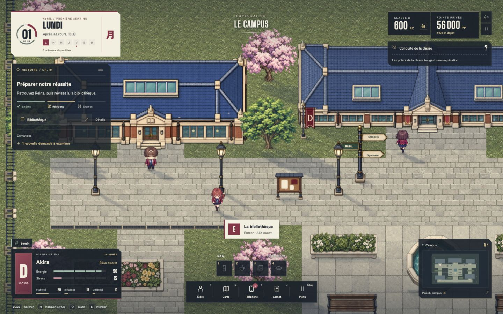
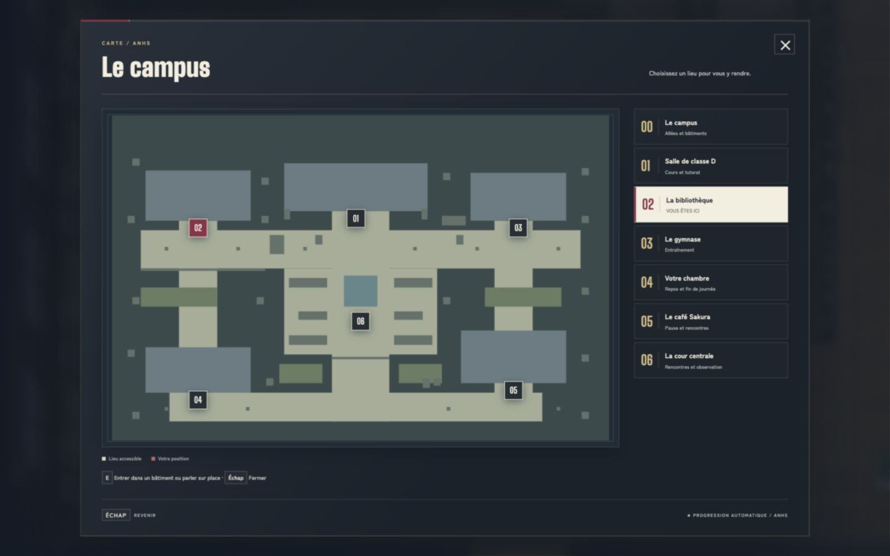
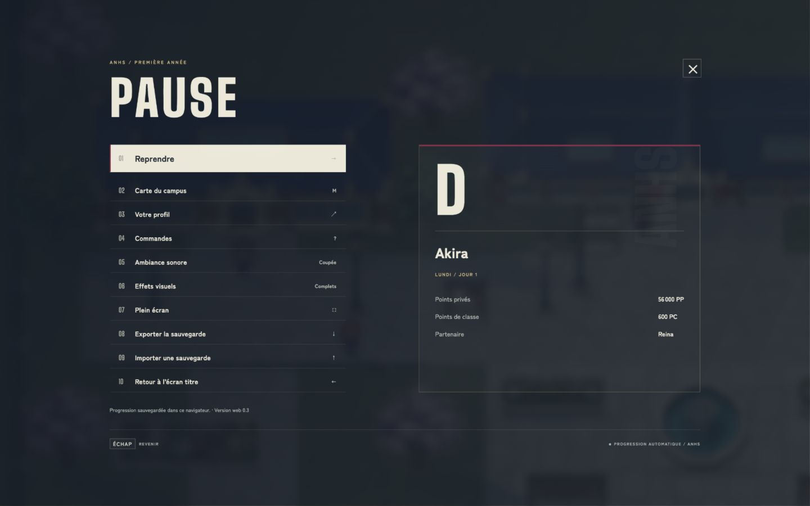
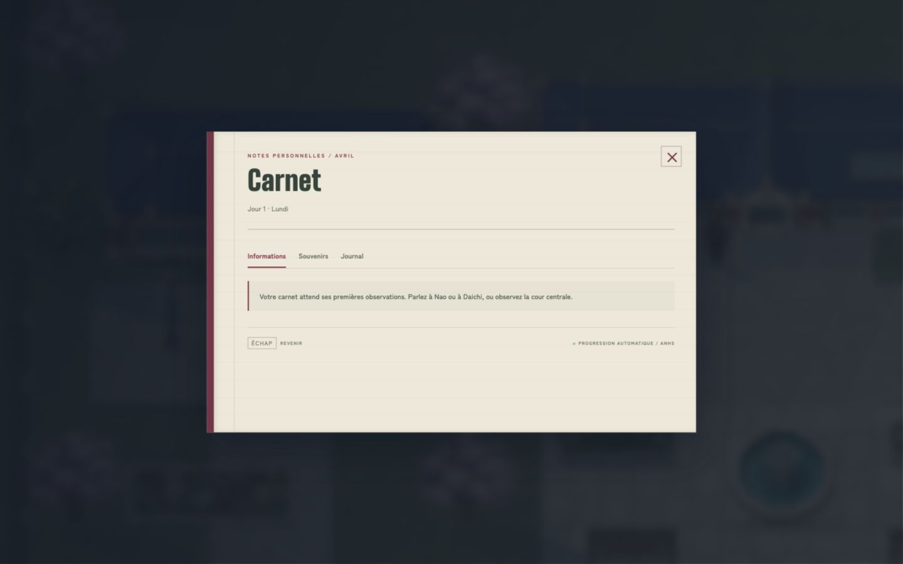
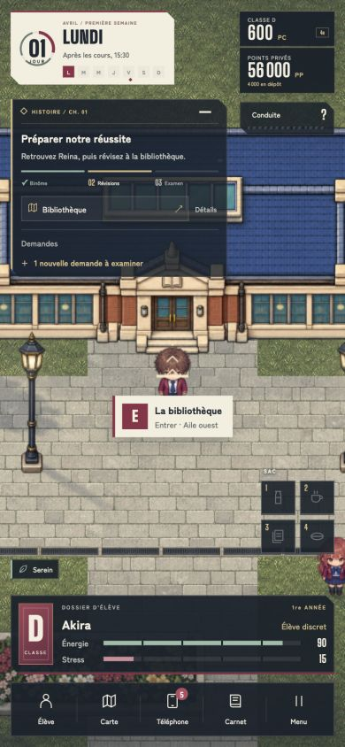

# HUD et interfaces v4 — ANHS

Refonte du HUD et des interfaces de jeu en HTML/CSS natifs : ivoire, bordeaux, encre et accents champagne. Les textes et contrôles restent dynamiques et accessibles ; aucun texte de jeu n’est figé dans une image.

- Calendrier avec semaine lisible, trois segments de créneaux et sceau du jour.
- Suivi de mission repliable, étapes liées au binôme, aux révisions et à l’examen ; accès à la bibliothèque ou à la classe D selon l’objectif.
- Carte d’élève, énergie, stress, réputation et états actifs.
- Sac rapide, dock à cinq accès, mini-carte ouvrant le plan du campus.
- Écran titre, pause, carte, carnet, profil, activités, dialogues, demandes, boutique et examens harmonisés.
- Dispositions bureau, tablette, portrait et paysage court ; commandes tactiles et mouvements réduits conservés.

Le téléphone (`phone.css`, `phone.mjs`) est conservé. Les styles des fenêtres v4 excluent explicitement `.iphone`, et le pied de fenêtre des menus n’est pas ajouté au téléphone.

## Fichiers actifs

- `web/dist/hud-v4.css` : HUD et dispositions adaptatives.
- `web/dist/interfaces-v4.css` : interfaces hors téléphone.
- `web/dist/index.html` : composition du HUD.
- `web/dist/app.mjs` : progression de mission, repli et raccourci, présentation des coûts d’activité et pied des fenêtres.

L’ancien `hud-v3.css` reste archivé et n’est plus chargé par le jeu. Sauvegarde des fichiers précédents : `.sauvegardes/interfaces-avant-hud-v4.tar.gz`.

## Vérification — 14 octobre 2026

- `node --check web/dist/app.mjs` : réussi.
- `npm test --prefix web` : 67 tests réussis.
- Contrôles visuels dans le navigateur : 1440 × 900, 929 × 877, 390 × 844 et 640 × 400.
- Contrôles manuels : ouverture des menus, repli/dépli de mission, destination, retour au jeu et téléphone sans pied de fenêtre ajouté.
- Empreintes du téléphone avant/après identiques (SHA-256) :
  - `phone.css` : `ccf13331bf72d2b426362c911ca03a293c3e331d038b2f80c44711502f777761`
  - `phone.mjs` : `0b0aa8a883baac752718086eb4e41344f16e1545f963d60d40fd38b17aa22520`

## Captures

