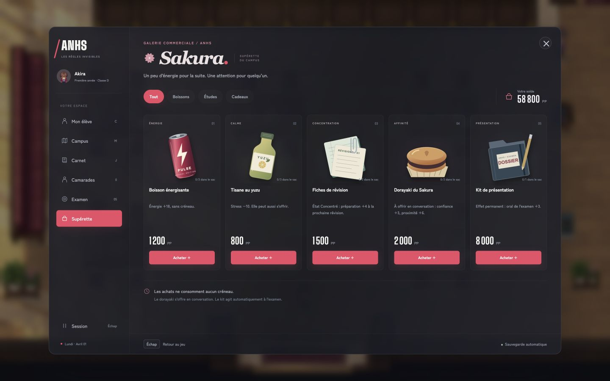
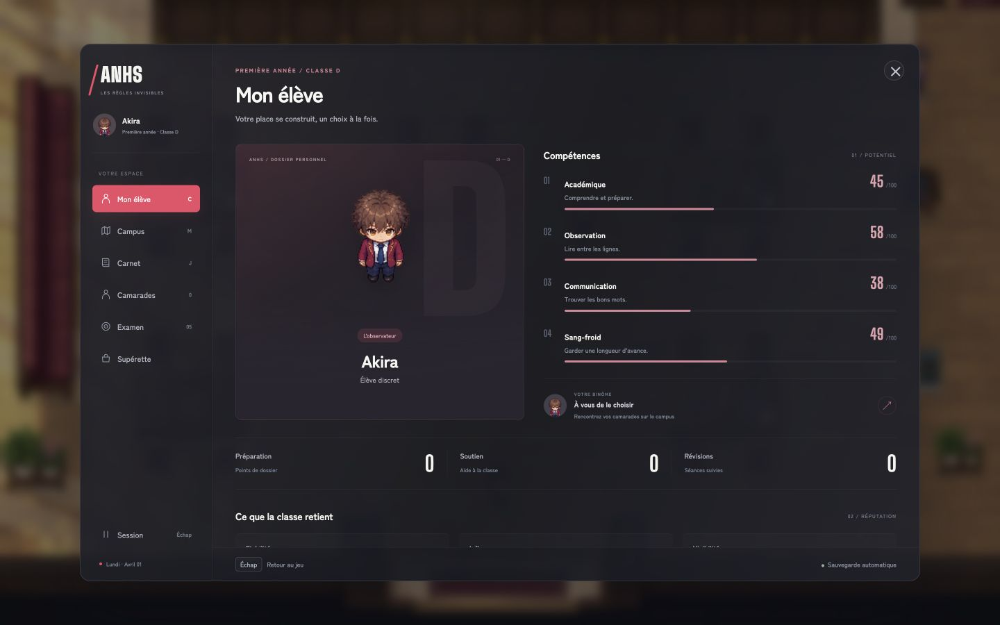
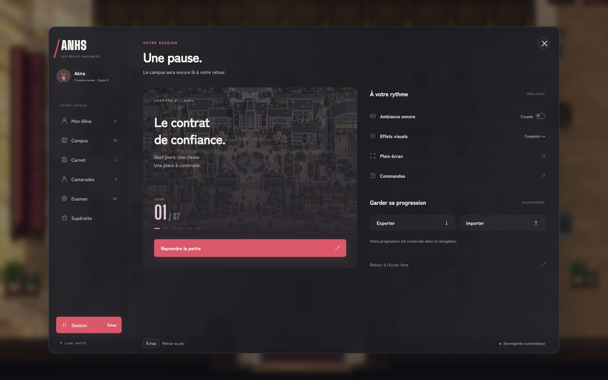
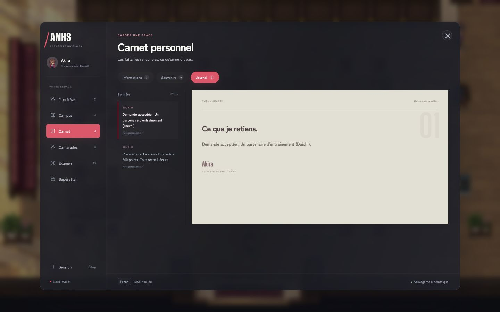
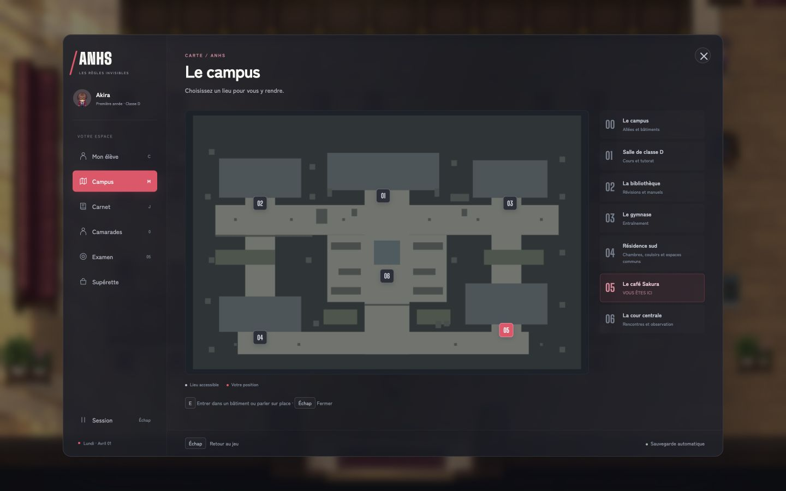
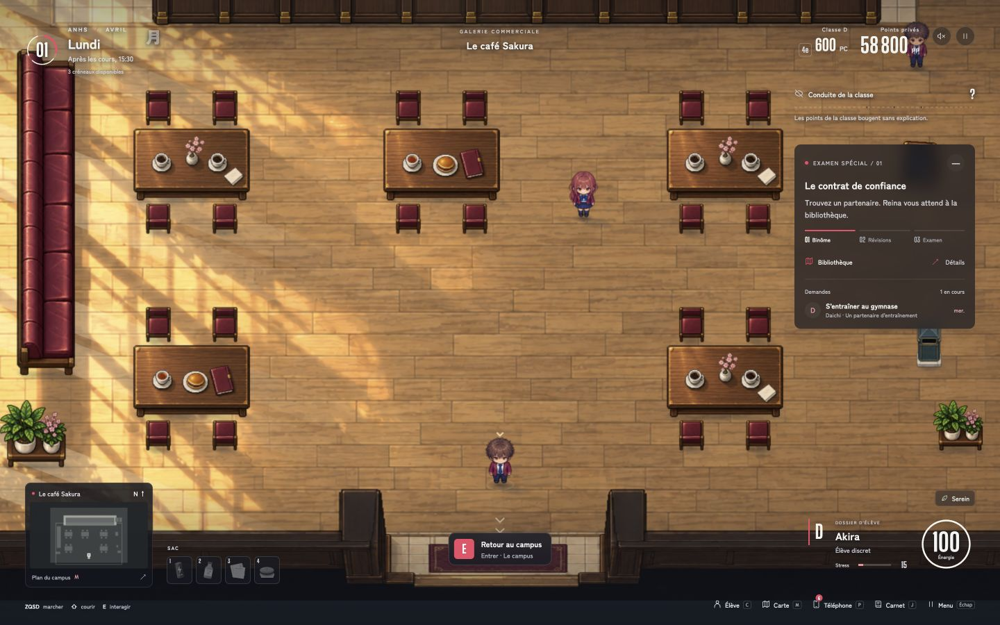
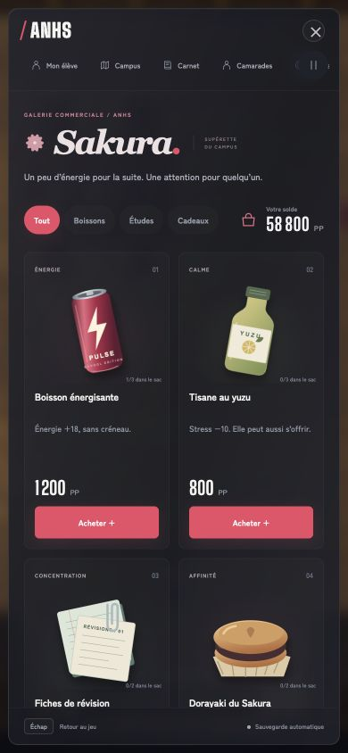
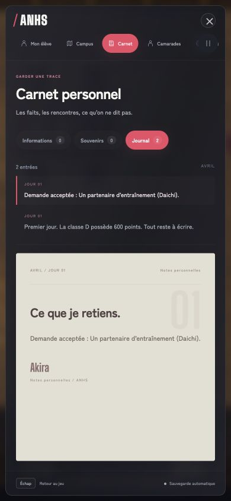

# ANHS — Interfaces v5 / surfaces fumées

Direction visuelle inspirée des deux références fournies : menus de jeu sombres avec navigation latérale et accents rouges ; HUD périphérique léger avec jauge circulaire. La refonte utilise le monde jouable en arrière-plan, des surfaces fumées, une typographie locale et un rouge rosé réservé aux actions et sélections.

## Écrans

- **Exploration** : date et créneaux en haut à gauche, points en haut à droite, objectif à droite, mini-carte et sac à gauche, élève et énergie circulaire à droite. Les raccourcis restent au bord de l’écran.
- **Supérette Sakura** : signature de magasin propre, cinq illustrations SVG originales, catégories réellement filtrantes, prix, quantités et achat. Les cinq objets se comparent sur une seule rangée sur grand écran ; les petits écrans utilisent trois ou deux colonnes et le défilement.
- **Profil** : personnage du jeu, identité de classe, aptitudes, binôme, préparation et réputation.
- **Carnet** : index des entrées et feuille de lecture. Informations, souvenirs et journal affichent leurs données et leur nombre d’entrées.
- **Camarades** : portraits, statut, promesse, échéance et récompense ; filtres nouvelles/en cours/archives, acceptation et refus.
- **Session** : couverture du chapitre, progression de la semaine, reprise, réglages et sauvegarde.
- **Carte, inscription, examens, activités et conversations** : même langage graphique ; règles de jeu conservées.

Les objets de boutique sont dessinés spécifiquement en SVG : canette PULSE, bouteille de yuzu, fiches annotées, dorayaki et dossier d’examen. Les portraits réutilisent les personnages du jeu. Aucun faux champ de recherche, statistique inventée ou bouton sans action n’a été ajouté.

## Téléphone

`phone.css` et `phone.mjs` sont inchangés. Le téléphone est exclu du nouveau conteneur, de la navigation latérale et des styles `.game-shell`. Contrôle visuel de l’écran d’accueil et vérification de l’absence de navigation/pied de fenêtre à l’intérieur de `.iphone`.

SHA-256 avant et après :
- `phone.css` : `ccf13331bf72d2b426362c911ca03a293c3e331d038b2f80c44711502f777761`
- `phone.mjs` : `0b0aa8a883baac752718086eb4e41344f16e1545f963d60d40fd38b17aa22520`

## Sources

- `web/dist/hud-v5.css`
- `web/dist/interfaces-v5.css`
- `web/dist/interface-kit.mjs`
- `web/dist/assets/ui-items/*.svg`
- Composition et contrôles : `web/dist/index.html`, `web/dist/app.mjs`.

Sauvegarde de la version précédente : `.sauvegardes/interfaces-avant-refonte-fumee.tar.gz`.

## Vérification du 14 octobre 2026

- Syntaxe des modules vérifiée avec Node.
- Suite du projet : **77 tests réussis**.
- Partie de test sur une origine locale séparée, sans utiliser la sauvegarde principale pour les achats et demandes.
- Essais fonctionnels : création d’élève, déplacement par carte, catégories Boissons/Études, achat à 1 200 PP, quantité du sac, utilisation et énergie à 100, acceptation de demande et filtre En cours, lecture du journal, navigation, fermeture et téléphone.
- Contrôles visuels : bureau, portrait 390 × 844 et paysage 640 × 400.

## Captures de validation

