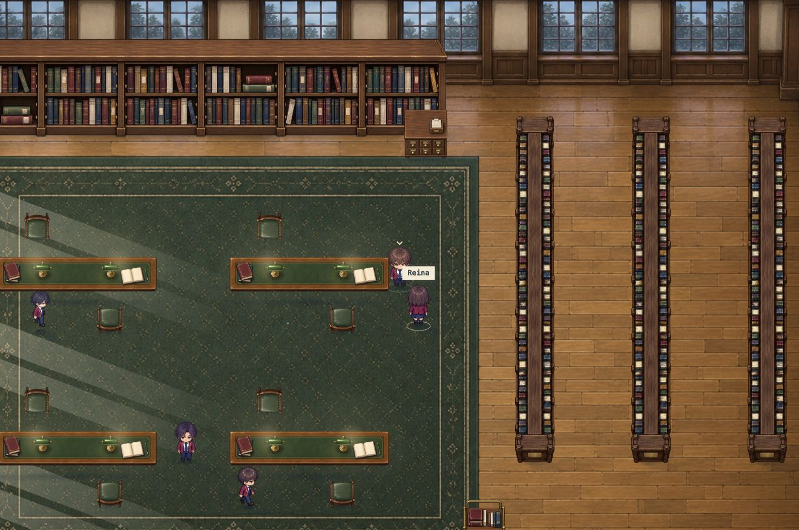

# Vérification de la qualité du rendu

## Résultats

- Les trente et un PNG ImageGen de `environment-v4/`, `library-v5/`, `exterior-v6/`, `cafe-v7/`, `residence-v8/` et `residence-v9/` sont identiques, octet par octet, aux fichiers générés d’origine. Aucune recompression ni réduction des fichiers. [Dimensions et empreintes SHA-256](integrite-assets.json).
- Dernier contrôle dans la résidence sur écran Retina à densité 2 : surface CSS 1416 × 877, canvas du monde **2832 × 1754** et canvas WebGL **2832 × 1754**. Le post-traitement reçoit donc la définition complète, sans image intermédiaire réduite.
- Aucun filtre CSS sur ces deux surfaces ; `image-rendering: auto`. Aucune erreur ni alerte console pendant le contrôle.
- 88 tests réussis, dont les contrôles des densités 1× à 4×, de la conservation des proportions et de l’ancrage, de l’utilisation directe des sources, de la répétition des clôtures / grilles sans étirement et des décors du Sakura et de la résidence. La résidence possède aussi un contrôle d’échelle après détourage alpha : meubles et portes sont comparés à la hauteur visible du personnage.

## Corrections

Le rendu respecte maintenant la densité native de l’écran, sans plafond systématique à 2×. Les dimensions physiques sont arrondies et la transformation utilise le rapport effectif avec la taille CSS.

Les sprites ImageGen ne sont plus étirés pour remplir un rectangle. La largeur prévue et l’ancrage au sol restent fixes ; la hauteur est calculée à partir des proportions du détourage original. Les tables sont centrées dans leur emplacement. Leur collision et celle du bâtiment académique ont été ajustées aux nouvelles proportions, avec validation des chemins et des interactions. Une dalle précédemment masquée par le bâtiment a été retirée.

Les coordonnées du shader utilisent `highp` pour éviter une précision insuffisante lors de l’échantillonnage des grandes textures Retina. Si WebGL ne peut pas s’initialiser, le rendu Canvas original reste affiché.

## Limites de la comparaison

Un PNG de 2000 pixels affiché sur un meuble de quelques centaines de pixels doit être rééchantillonné : tous ses microdétails ne peuvent pas rester visibles simultanément. Le jeu utilise directement le fichier original avec un lissage de haute qualité, sans fabriquer une version miniature puis l’agrandir. Le fond de salle est composé en neuf sections pour aligner ses murs avec le mapping.

Les lumières, les ombres et l’étalonnage du jeu peuvent modifier volontairement la luminosité et les teintes. Ils restent actifs ; cela ne constitue pas une compression du fichier. La capture ci-dessous montre le rendu réel avec cet éclairage, sans le HUD pour faciliter l’inspection.

